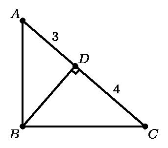
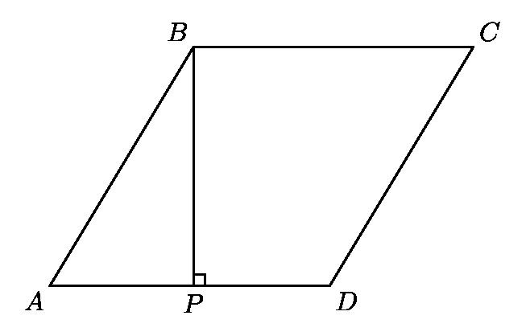

# AVP0205 — Single visual target

MathVision:2166 / MathVision:2249 · same type · Geometric markers

## Shared or similar visual information

A small square or rotated-square angle marker where two lines meet.

## Evidence locations

- Left image: The rotated square at D, where BD meets the sloping line AC.
- Right image: The small square at P on the base AD, next to the vertical BP.

## Mathematical meanings

Left image: BD is perpendicular to AC at D. Right image: BP is perpendicular to AD at P.

## Same mathematical meanings

yes

## Rationales

In both locations the square is attached to the angle between the intersecting lines, so the conventional symbol asserts perpendicularity. Rotation, fill and the surrounding construction do not change the right-angle meaning.

Only the selected target is annotated. AI visual-review draft; not independently double-annotated by humans.
