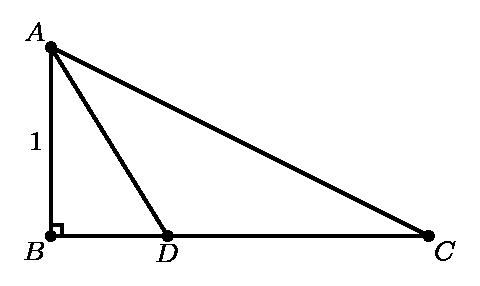
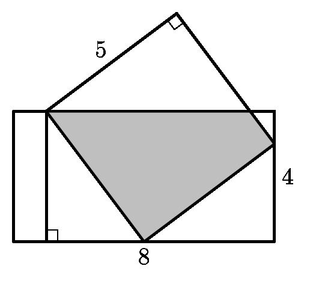

# AVP0206 — Single visual target

MathVision:2175 / MathVision:2250 · same type · Geometric markers

## Shared or similar visual information

A small square or rotated-square angle marker where two lines meet.

## Evidence locations

- Left image: The small square at B between AB and BC.
- Right image: The tilted square at the top vertex of the sloping overlaid triangle.

## Mathematical meanings

Left image: AB is perpendicular to BC at B. Right image: The two sloping sides at that upper vertex meet at a right angle.

## Same mathematical meanings

yes

## Rationales

In both locations the square is attached to the angle between the intersecting lines, so the conventional symbol asserts perpendicularity. Rotation, fill and the surrounding construction do not change the right-angle meaning.

Only the selected target is annotated. AI visual-review draft; not independently double-annotated by humans.
