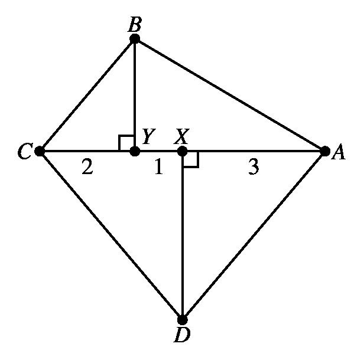
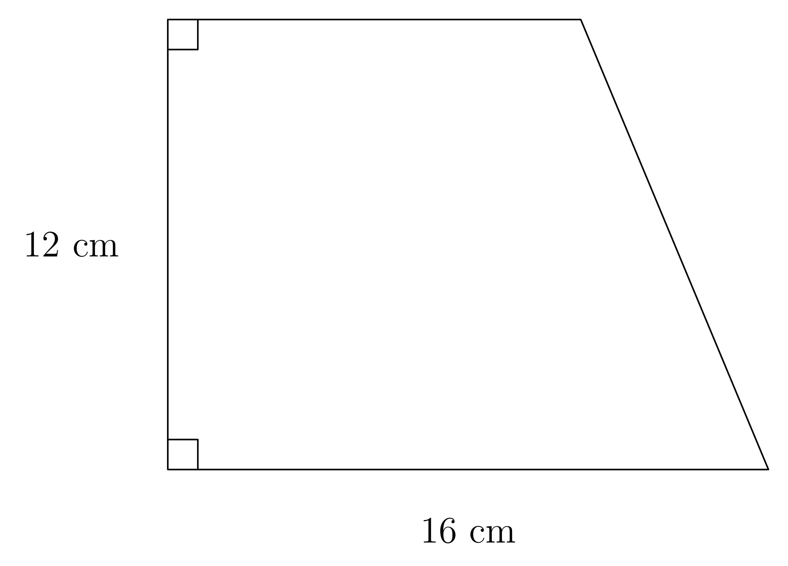

# AVP0216 — Single visual target

MathVision:2494 / MathVision:2952 · same type · Geometric markers

## Shared or similar visual information

A small square or rotated-square angle marker where two lines meet.

## Evidence locations

- Left image: The small square at Y, immediately left of the vertical segment BY on CA.
- Right image: The small square at the upper-left vertex of the trapezoid.

## Mathematical meanings

Left image: BY is perpendicular to CA at Y. Right image: The left side of the trapezoid is perpendicular to its upper horizontal side.

## Same mathematical meanings

yes

## Rationales

In both locations the square is attached to the angle between the intersecting lines, so the conventional symbol asserts perpendicularity. Rotation, fill and the surrounding construction do not change the right-angle meaning.

Only the selected target is annotated. AI visual-review draft; not independently double-annotated by humans.
