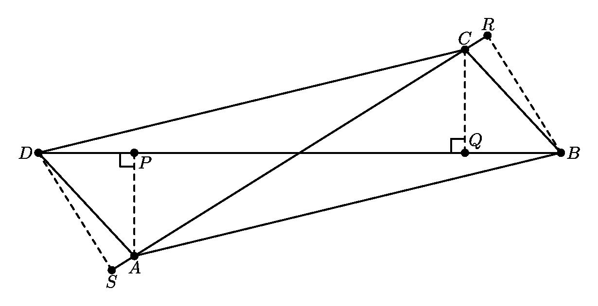
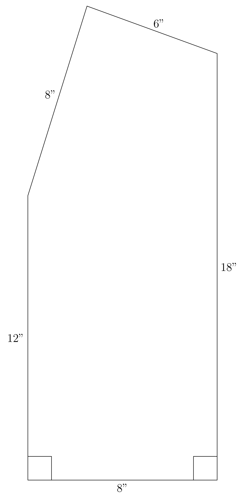

# AVP0217 — Single visual target

MathVision:2496 / MathVision:2962 · same type · Geometric markers

## Shared or similar visual information

A small square or rotated-square angle marker where two lines meet.

## Evidence locations

- Left image: The small square at P on the diagonal DB, next to the dashed projection from A.
- Right image: The small square at the lower-left corner of the outlined polygon.

## Mathematical meanings

Left image: AP is perpendicular to DB at the projection foot P. Right image: The left boundary segment and the bottom boundary segment are perpendicular.

## Same mathematical meanings

yes

## Rationales

In both locations the square is attached to the angle between the intersecting lines, so the conventional symbol asserts perpendicularity. Rotation, fill and the surrounding construction do not change the right-angle meaning.

Only the selected target is annotated. AI visual-review draft; not independently double-annotated by humans.
