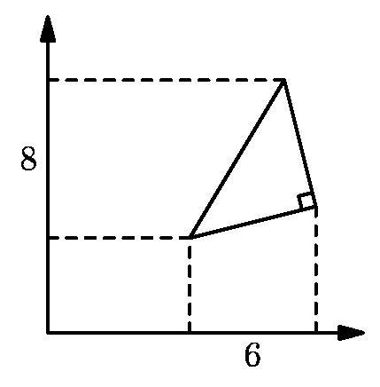
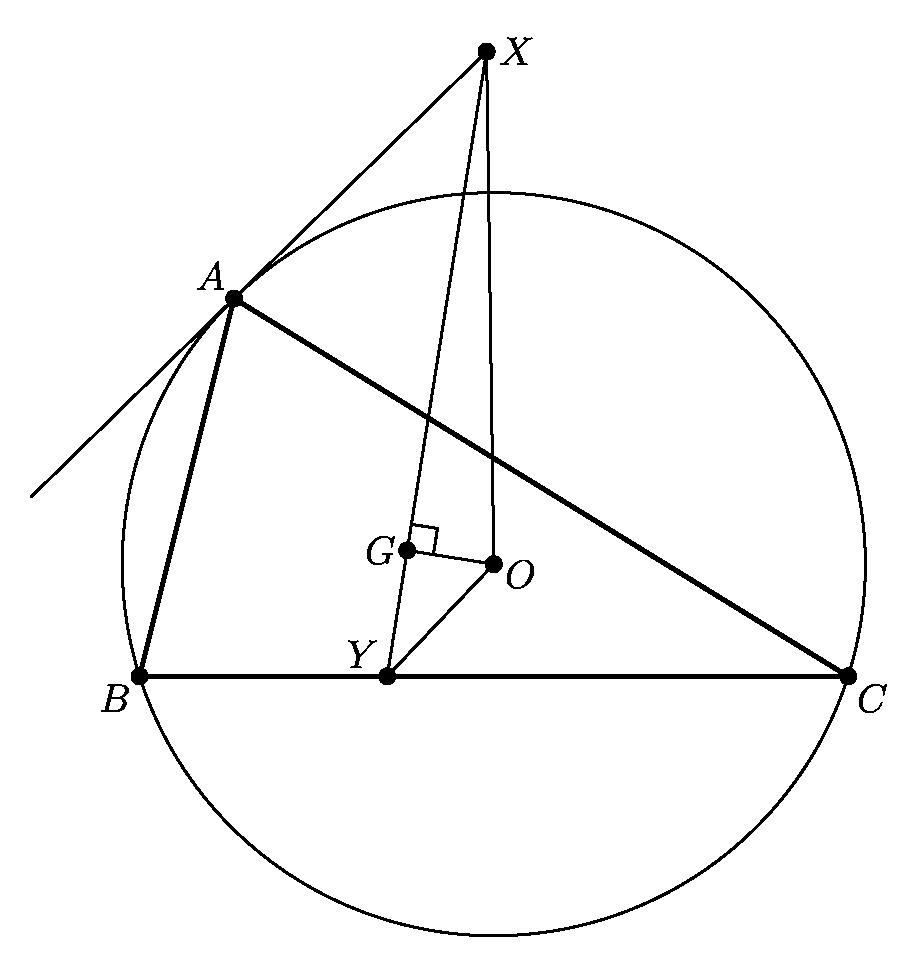

# AVP0220 — Single visual target

MathVision:2821 / MathVision:2099 · same type · Geometric markers

## Shared or similar visual information

A small square or rotated-square angle marker where two lines meet.

## Evidence locations

- Left image: The rotated square at the lower-right vertex of the triangle, between its two solid sides.
- Right image: The small square at G, where the line through X and Y meets GO.

## Mathematical meanings

Left image: The two triangle sides meeting at that vertex are perpendicular. Right image: GO is perpendicular to the line XY at G.

## Same mathematical meanings

yes

## Rationales

In both locations the square is attached to the angle between the intersecting lines, so the conventional symbol asserts perpendicularity. Rotation, fill and the surrounding construction do not change the right-angle meaning.

Only the selected target is annotated. AI visual-review draft; not independently double-annotated by humans.
