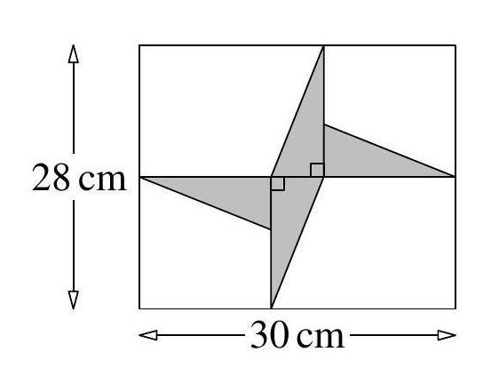
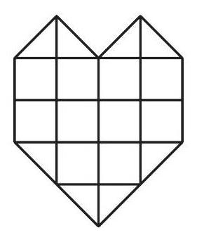

# AVP0221 — Single visual target

MathVision:1774 / MathVision:23 · same type · Geometric markers

## Shared or similar visual information

A small square or similar rectangular outline formed by straight segments.

## Evidence locations

- Left image: The lower of the two tiny square marks at the central crossing of the horizontal and vertical internal lines.
- Right image: The top-left complete square cell immediately beneath the left triangular roof.

## Mathematical meanings

Left image: The intersecting horizontal and vertical internal lines are perpendicular. Right image: It is a square cell in a subdivision of the heart-shaped planar figure.

## Same mathematical meanings

no

## Rationales

The left square directly brackets two intersecting lines and encodes a right-angle relation. The selected right element instead has this object or subdivision role: It is a square cell in a subdivision of the heart-shaped planar figure. That outline depicts a region or component; it does not function as the separate angle-relation symbol selected on the left.

Only the selected target is annotated. AI visual-review draft; not independently double-annotated by humans.
