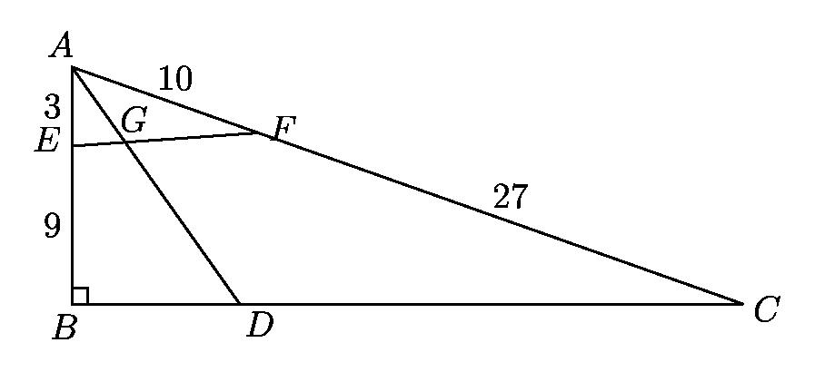
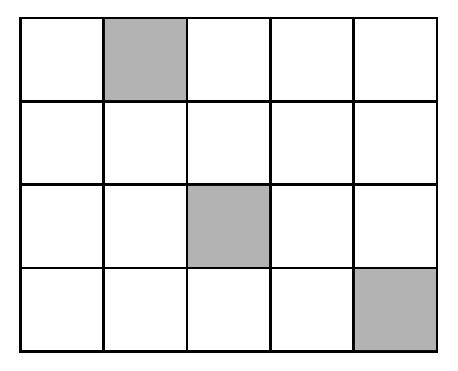

# AVP0222 — Single visual target

MathVision:2063 / MathVision:2492 · same type · Geometric markers

## Shared or similar visual information

A small square or similar rectangular outline formed by straight segments.

## Evidence locations

- Left image: The small outlined square at B, where AB meets BC.
- Right image: The unshaded upper-left square cell in the rectangular grid.

## Mathematical meanings

Left image: AB is perpendicular to BC at B. Right image: It is a cell of the tiled rectangular board, serving as part of the board subdivision.

## Same mathematical meanings

no

## Rationales

The left square directly brackets two intersecting lines and encodes a right-angle relation. The selected right element instead has this object or subdivision role: It is a cell of the tiled rectangular board, serving as part of the board subdivision. That outline depicts a region or component; it does not function as the separate angle-relation symbol selected on the left.

Only the selected target is annotated. AI visual-review draft; not independently double-annotated by humans.
