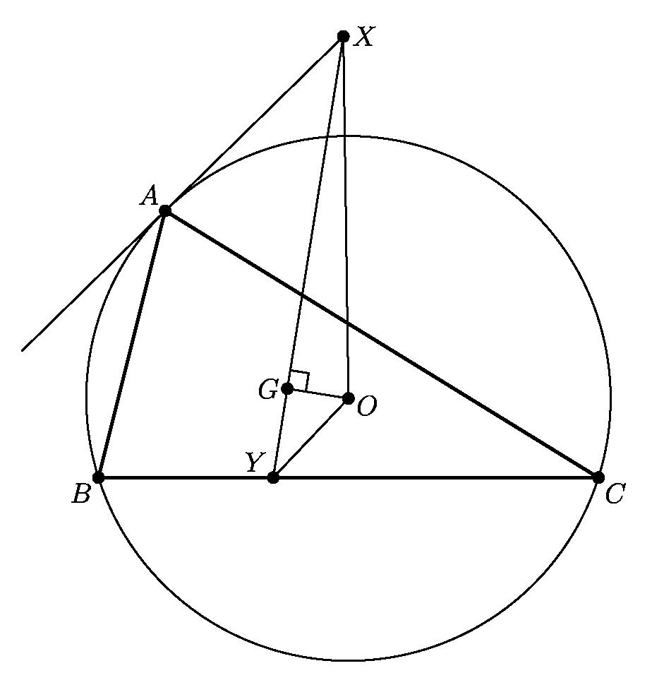
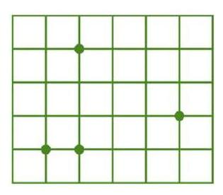

# AVP0223 — Single visual target

MathVision:2099 / MathVision:1439 · same type · Geometric markers

## Shared or similar visual information

A small square or similar rectangular outline formed by straight segments.

## Evidence locations

- Left image: The small square at G, where the line through X and Y meets GO.
- Right image: The square cell in the upper-left corner of the green lattice.

## Mathematical meanings

Left image: GO is perpendicular to the line XY at G. Right image: It is a square cell of the background lattice used to locate the green points.

## Same mathematical meanings

no

## Rationales

The left square directly brackets two intersecting lines and encodes a right-angle relation. The selected right element instead has this object or subdivision role: It is a square cell of the background lattice used to locate the green points. That outline depicts a region or component; it does not function as the separate angle-relation symbol selected on the left.

Only the selected target is annotated. AI visual-review draft; not independently double-annotated by humans.
