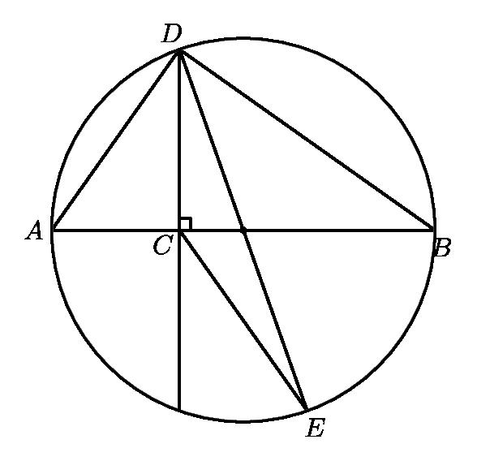
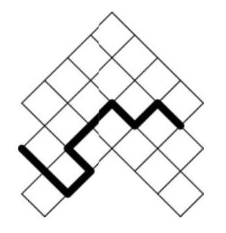

# AVP0224 — Single visual target

MathVision:2147 / MathVision:842 · same type · Geometric markers

## Shared or similar visual information

A small square or similar rectangular outline formed by straight segments.

## Evidence locations

- Left image: The small black square beside C, where the vertical diameter line meets AB.
- Right image: The uppermost complete tilted square cell of the diagonal lattice.

## Mathematical meanings

Left image: The line through D, C and E is perpendicular to AB at C. Right image: It is a cell of the tilted lattice on which the heavy broken path is drawn.

## Same mathematical meanings

no

## Rationales

The left square directly brackets two intersecting lines and encodes a right-angle relation. The selected right element instead has this object or subdivision role: It is a cell of the tilted lattice on which the heavy broken path is drawn. That outline depicts a region or component; it does not function as the separate angle-relation symbol selected on the left.

Only the selected target is annotated. AI visual-review draft; not independently double-annotated by humans.
