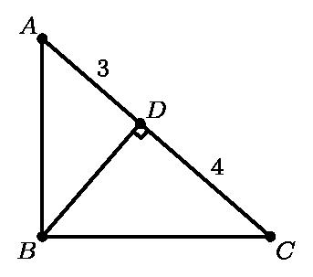
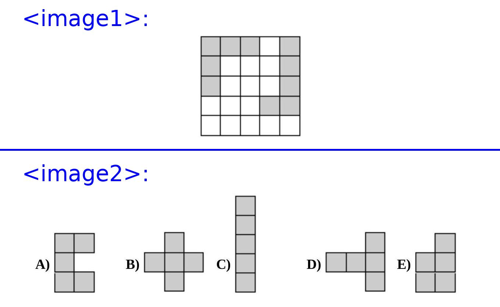

# AVP0225 — Single visual target

MathVision:2166 / MathVision:803 · same type · Geometric markers

## Shared or similar visual information

A small square or similar rectangular outline formed by straight segments.

## Evidence locations

- Left image: The rotated square at D, where BD meets the sloping line AC.
- Right image: The upper-left square cell of the top figure above the blue separator.

## Mathematical meanings

Left image: BD is perpendicular to AC at D. Right image: It is a cell of the board in the top shape, part of a discrete planar subdivision.

## Same mathematical meanings

no

## Rationales

The left square directly brackets two intersecting lines and encodes a right-angle relation. The selected right element instead has this object or subdivision role: It is a cell of the board in the top shape, part of a discrete planar subdivision. That outline depicts a region or component; it does not function as the separate angle-relation symbol selected on the left.

Only the selected target is annotated. AI visual-review draft; not independently double-annotated by humans.
