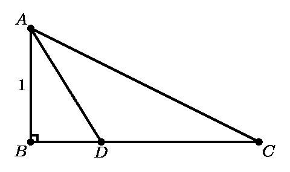
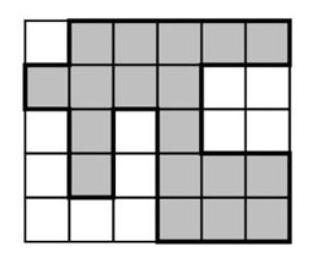

# AVP0226 — Single visual target

MathVision:2175 / MathVision:1486 · same type · Geometric markers

## Shared or similar visual information

A small square or similar rectangular outline formed by straight segments.

## Evidence locations

- Left image: The small square at B between AB and BC.
- Right image: The unshaded square at the top-left corner of the board.

## Mathematical meanings

Left image: AB is perpendicular to BC at B. Right image: It is one square cell of the board, distinguished from nearby shaded cells.

## Same mathematical meanings

no

## Rationales

The left square directly brackets two intersecting lines and encodes a right-angle relation. The selected right element instead has this object or subdivision role: It is one square cell of the board, distinguished from nearby shaded cells. That outline depicts a region or component; it does not function as the separate angle-relation symbol selected on the left.

Only the selected target is annotated. AI visual-review draft; not independently double-annotated by humans.
