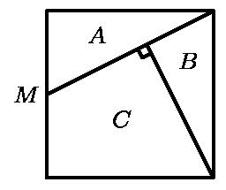
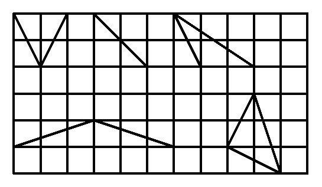

# AVP0227 — Single visual target

MathVision:2176 / MathVision:2523 · same type · Geometric markers

## Shared or similar visual information

A small square or similar rectangular outline formed by straight segments.

## Evidence locations

- Left image: The rotated small square where the internal descending segment meets the rising segment from M.
- Right image: An uncut square grid cell along the bottom edge near the center, beneath the sloping triangle strokes.

## Mathematical meanings

Left image: The two internal segments meeting at the marked intersection are perpendicular. Right image: It is a square lattice cell used as a reference in the drawing of triangles.

## Same mathematical meanings

no

## Rationales

The left square directly brackets two intersecting lines and encodes a right-angle relation. The selected right element instead has this object or subdivision role: It is a square lattice cell used as a reference in the drawing of triangles. That outline depicts a region or component; it does not function as the separate angle-relation symbol selected on the left.

Only the selected target is annotated. AI visual-review draft; not independently double-annotated by humans.
