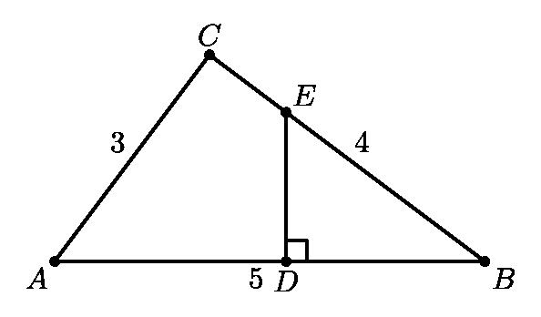
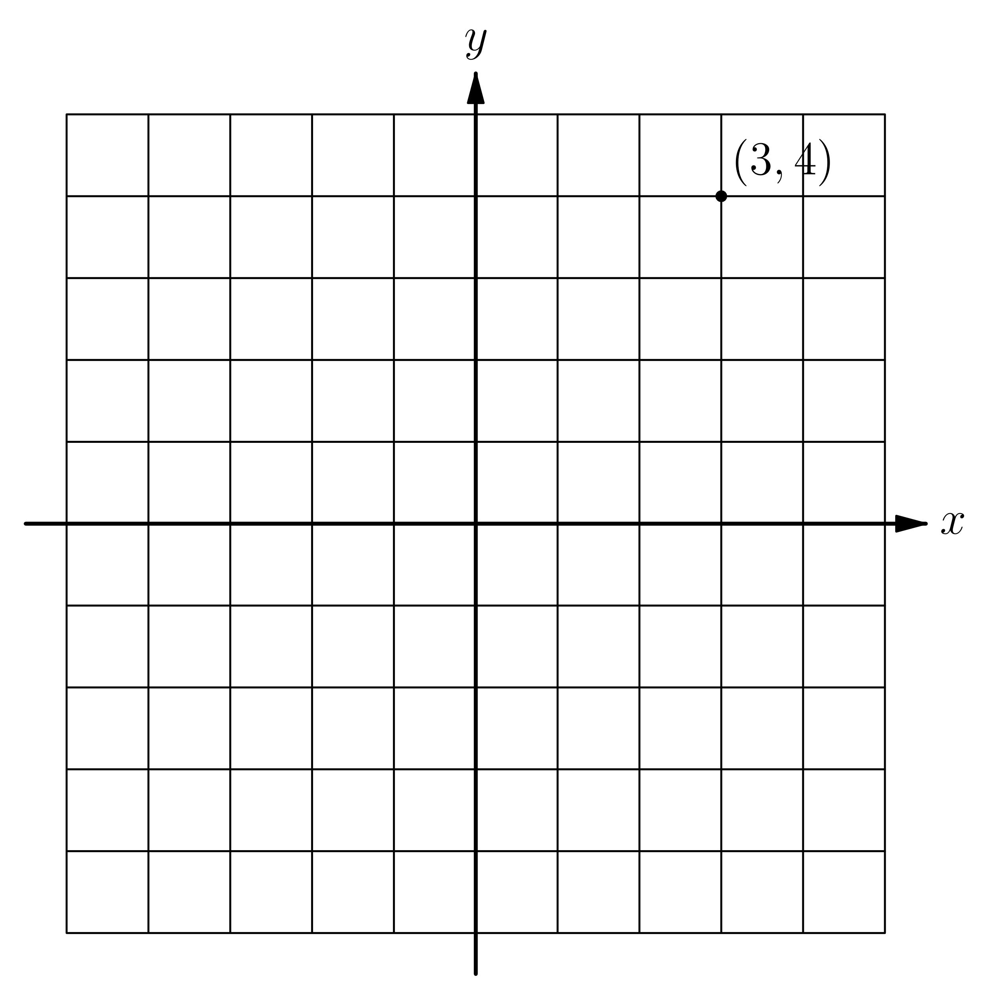

# AVP0228 — Single visual target

MathVision:2180 / MathVision:2955 · same type · Geometric markers

## Shared or similar visual information

A small square or similar rectangular outline formed by straight segments.

## Evidence locations

- Left image: The small square at D where ED meets the horizontal base AB.
- Right image: A small square coordinate-grid cell immediately above and to the right of the axes intersection.

## Mathematical meanings

Left image: ED is perpendicular to AB at D. Right image: It is a coordinate-grid cell providing a background spatial reference for the point plot.

## Same mathematical meanings

no

## Rationales

The left square directly brackets two intersecting lines and encodes a right-angle relation. The selected right element instead has this object or subdivision role: It is a coordinate-grid cell providing a background spatial reference for the point plot. That outline depicts a region or component; it does not function as the separate angle-relation symbol selected on the left.

Only the selected target is annotated. AI visual-review draft; not independently double-annotated by humans.
