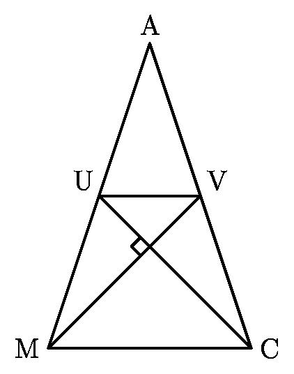
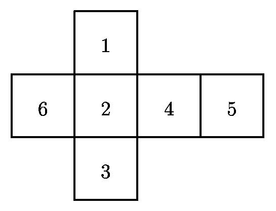

# AVP0229 — Single visual target

MathVision:2226 / MathVision:2532 · different type · Geometric markers

## Shared or similar visual information

A small square or similar rectangular outline formed by straight segments.

## Evidence locations

- Left image: The tilted small square where UC crosses MV inside the triangle.
- Right image: The top square labeled 1 in the cross-shaped net.

## Mathematical meanings

Left image: UC is perpendicular to MV at their intersection. Right image: It is a face in the unfolded net of a number cube.

## Same mathematical meanings

no

## Rationales

The left square directly brackets two intersecting lines and encodes a right-angle relation. The selected right element instead has this object or subdivision role: It is a face in the unfolded net of a number cube. That outline depicts a region or component; it does not function as the separate angle-relation symbol selected on the left.

Only the selected target is annotated. AI visual-review draft; not independently double-annotated by humans.
