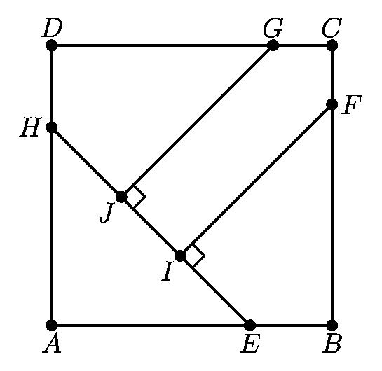
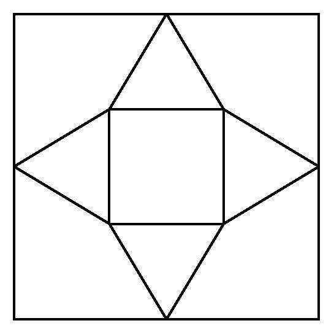

# AVP0230 — Single visual target

MathVision:2230 / MathVision:2079 · different type · Geometric markers

## Shared or similar visual information

A small square or similar rectangular outline formed by straight segments.

## Evidence locations

- Left image: The tilted square at J on the segment HE, beside the segment from G.
- Right image: The central inner square surrounded by four triangles.

## Mathematical meanings

Left image: GJ is perpendicular to HE at J. Right image: It is the square base in the planar layout that folds to form a pyramid.

## Same mathematical meanings

no

## Rationales

The left square directly brackets two intersecting lines and encodes a right-angle relation. The selected right element instead has this object or subdivision role: It is the square base in the planar layout that folds to form a pyramid. That outline depicts a region or component; it does not function as the separate angle-relation symbol selected on the left.

Only the selected target is annotated. AI visual-review draft; not independently double-annotated by humans.
