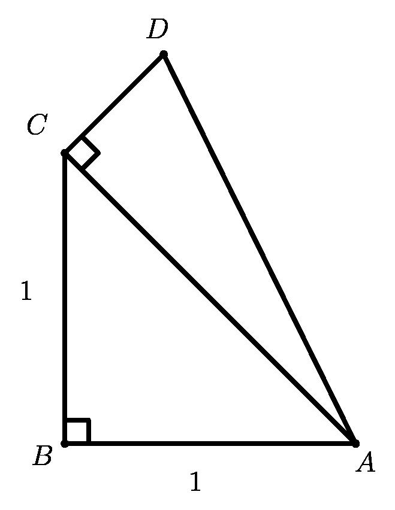
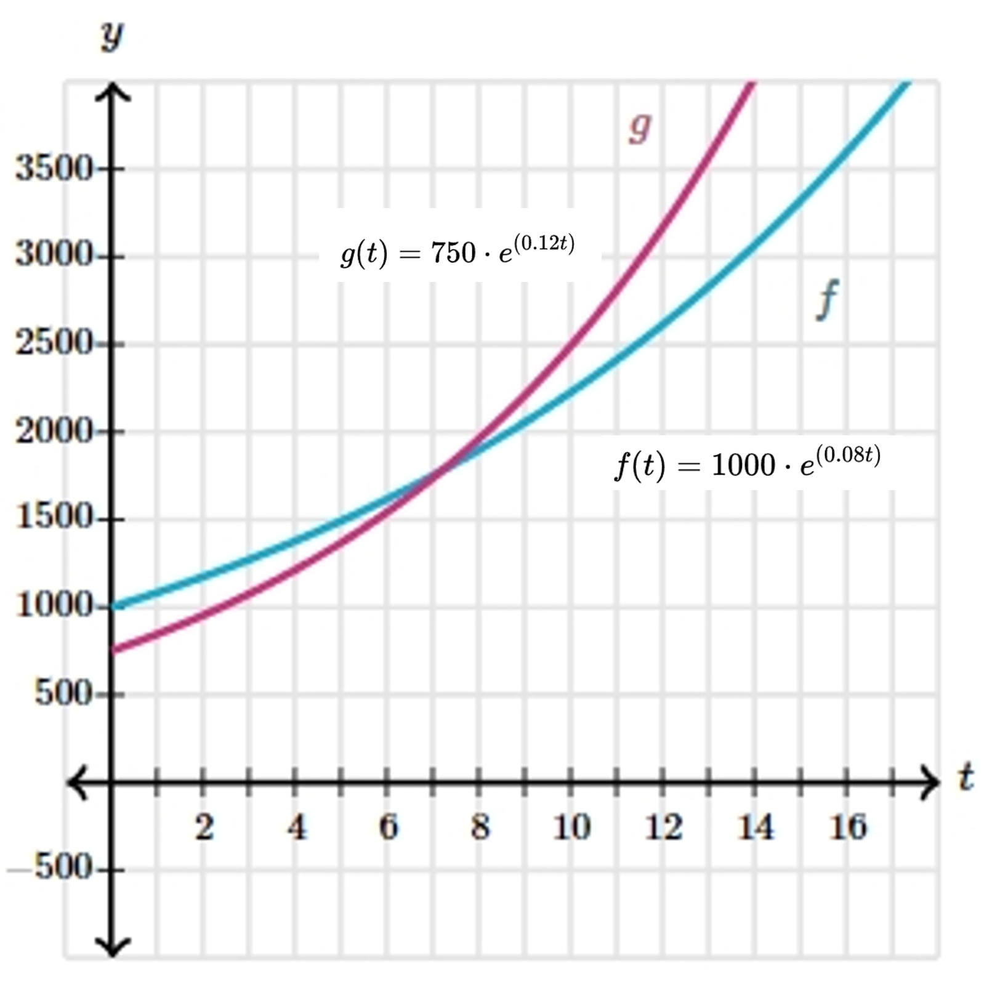

# AVP0235 — Single visual target

MathVision:2490 / MathVerse:520 · different type · Geometric markers

## Shared or similar visual information

A small square or similar rectangular outline formed by straight segments.

## Evidence locations

- Left image: The tilted square at C between the segments CD and CA.
- Right image: A complete small rectangular grid cell beside the plotted graph, away from the thick axes.

## Mathematical meanings

Left image: CD is perpendicular to CA at C. Right image: It is a background coordinate-grid cell used as a spatial reference when reading the graph.

## Same mathematical meanings

no

## Rationales

The left square directly brackets two intersecting lines and encodes a right-angle relation. The selected right element instead has this object or subdivision role: It is a background coordinate-grid cell used as a spatial reference when reading the graph. That outline depicts a region or component; it does not function as the separate angle-relation symbol selected on the left.

Only the selected target is annotated. AI visual-review draft; not independently double-annotated by humans.
