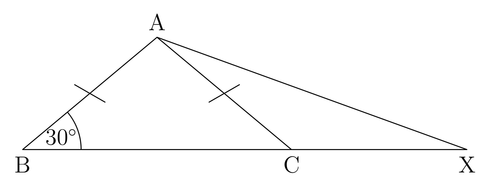
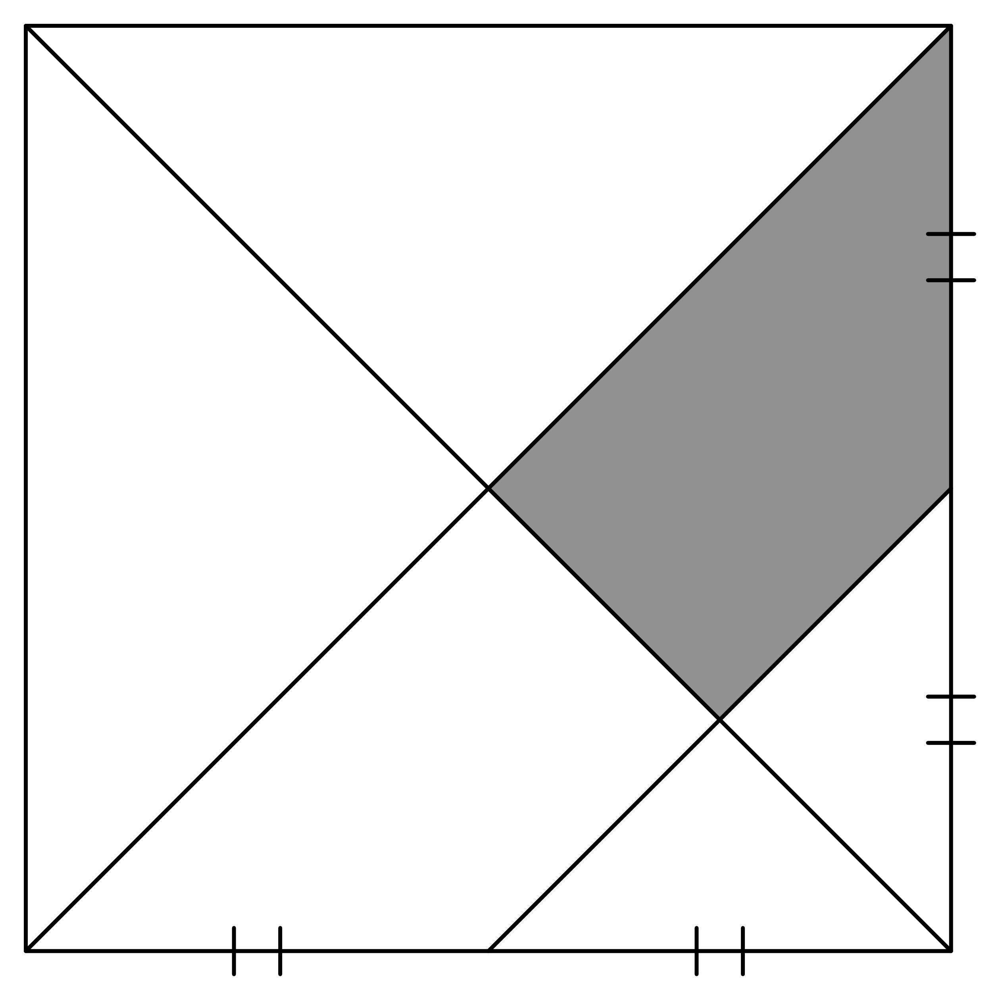

# AVP0250 — Single visual target

MathVision:2934 / MathVision:2953 · same type · Geometric markers

## Shared or similar visual information

Short transverse tick strokes repeated across line segments.

## Evidence locations

- Left image: The slash on AB, with the matching slash on AC.
- Right image: The pair of short ticks crossing each of the two bottom-edge portions.

## Mathematical meanings

Left image: It marks AB and AC as equal in length. Right image: It marks the two bottom-edge portions as equal in length.

## Same mathematical meanings

yes

## Rationales

On both sides matching transverse ticks group segments that have equal lengths within that diagram. A single-tick group and a double-tick group use the same equality convention; this does not assert equal numerical lengths between the two separate problems.

Only the selected target is annotated. AI visual-review draft; not independently double-annotated by humans.
