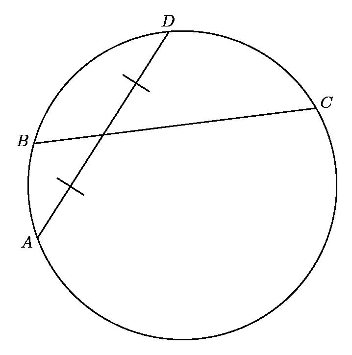
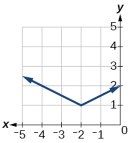

# AVP0254 — Single visual target

MathVision:2038 / MathVerse:505 · different type · Geometric markers

## Shared or similar visual information

A short stroke crossing a longer line.

## Evidence locations

- Left image: The slash on the lower portion of chord AD, matched by a slash on its upper portion.
- Right image: The short vertical stroke crossing the horizontal axis immediately above the label -2.

## Mathematical meanings

Left image: It marks the two pieces of chord AD cut by BC as equal in length. Right image: It is a coordinate-axis tick marking a position at which a horizontal coordinate can be read.

## Same mathematical meanings

no

## Rationales

The matching strokes on the left encode equality of the marked segment lengths. On the right the short stroke lies on a coordinate axis and marks a reading position. Coordinate ticks do not assert that nearby graph segments have equal lengths.

Only the selected target is annotated. AI visual-review draft; not independently double-annotated by humans.
