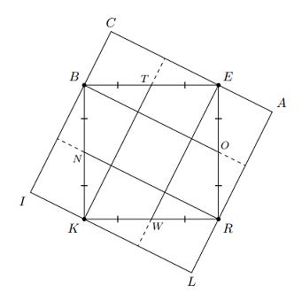
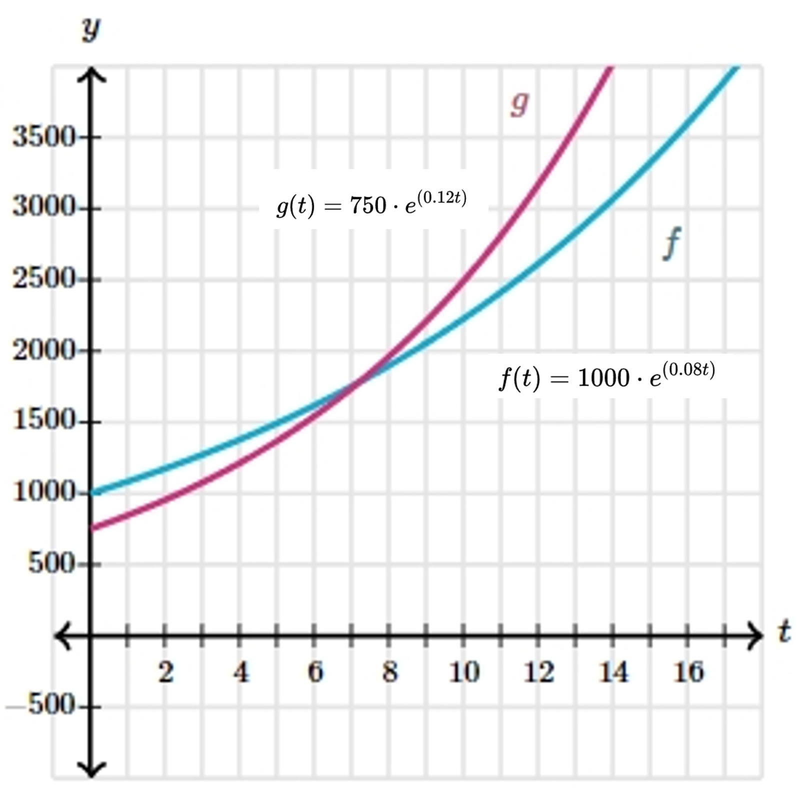

# AVP0255 — Single visual target

MathVision:2809 / MathVerse:520 · different type · Geometric markers

## Shared or similar visual information

A short stroke crossing a longer line.

## Evidence locations

- Left image: The short tick on BT, with a matching tick on TE along the top of the inner square.
- Right image: A short vertical reading stroke crossing the horizontal coordinate axis on its positive side.

## Mathematical meanings

Left image: It marks BT and TE as equal-length pieces of the segment BE. Right image: It is a coordinate-axis tick marking a position at which a horizontal coordinate can be read.

## Same mathematical meanings

no

## Rationales

The matching strokes on the left encode equality of the marked segment lengths. On the right the short stroke lies on a coordinate axis and marks a reading position. Coordinate ticks do not assert that nearby graph segments have equal lengths.

Only the selected target is annotated. AI visual-review draft; not independently double-annotated by humans.
