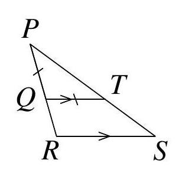
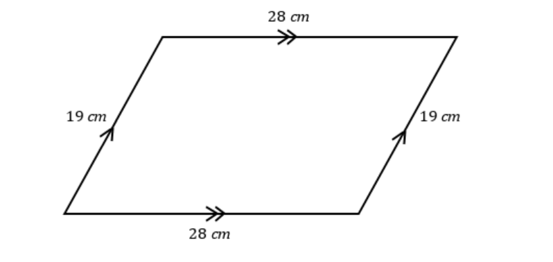

# AVP0263 — Single visual target

MathVision:1783 / MathVerse:417 · same type · Geometric markers

## Shared or similar visual information

Matching chevron-shaped arrow marks drawn inside a pair of line segments.

## Evidence locations

- Left image: The right-pointing chevrons inside QT and RS.
- Right image: The matching double chevrons across the upper and lower horizontal sides of the parallelogram.

## Mathematical meanings

Left image: The matching arrow marks state that QT and RS are parallel. Right image: The matching double-arrow marks state that the upper and lower sides are parallel.

## Same mathematical meanings

yes

## Rationales

The arrow marks are repeated on two separate sides within each image, which is the geometric convention for parallel lines. Their purpose is a parallelism relation, irrespective of single versus double chevrons.

Only the selected target is annotated. AI visual-review draft; not independently double-annotated by humans.
