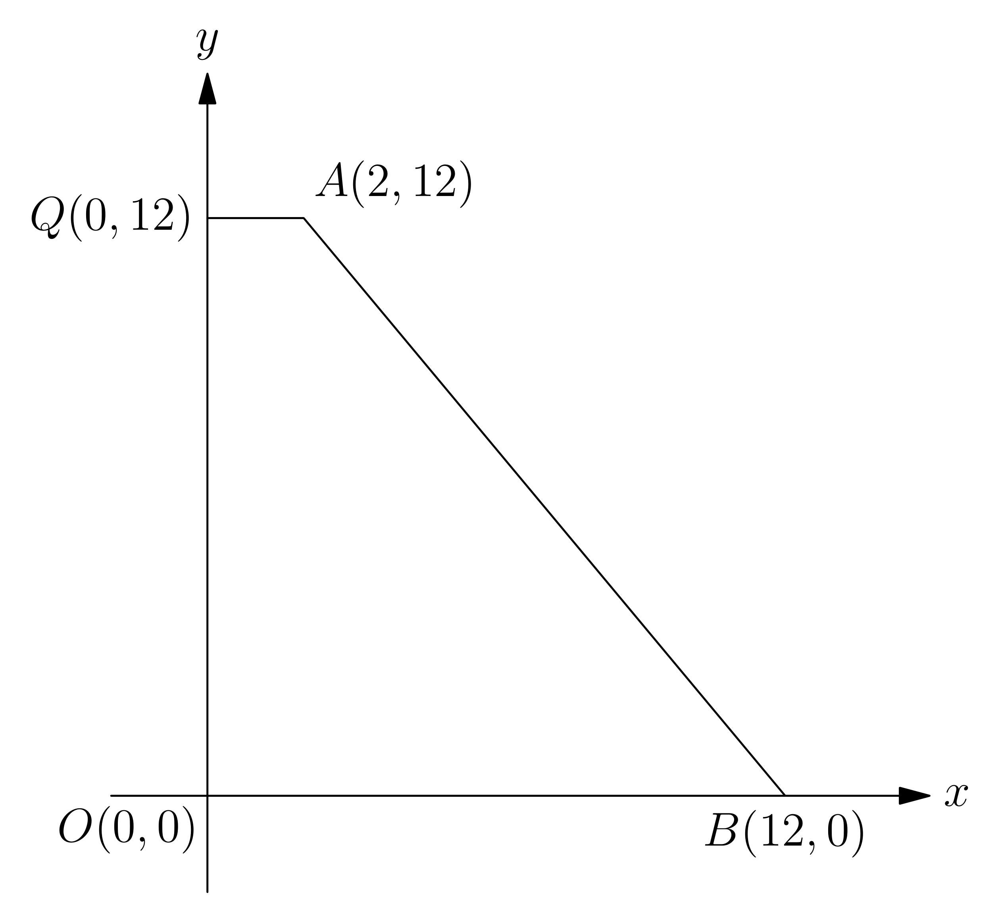
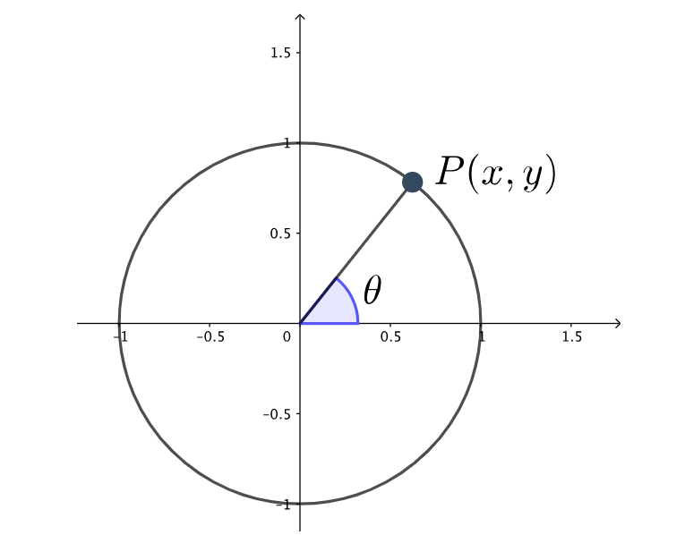

# AVP0264 — Single visual target

MathVision:2958 / MathVerse:449 · same type · Geometric markers

## Shared or similar visual information

A right-pointing arrowhead at the far end of a horizontal coordinate axis.

## Evidence locations

- Left image: The arrowhead at the far-right end of the x-axis, beyond B.
- Right image: The arrowhead at the far-right end of the x-axis, beyond the 1.5 tick.

## Mathematical meanings

Left image: It indicates the positive x direction and continuation of the coordinate axis. Right image: It indicates the positive x direction and continuation of the coordinate axis.

## Same mathematical meanings

yes

## Rationales

Both arrowheads are attached to the positive end of an x-axis and indicate its positive direction and continuation. A quadrilateral drawing and a unit-circle diagram use that same coordinate convention.

Only the selected target is annotated. AI visual-review draft; not independently double-annotated by humans.
