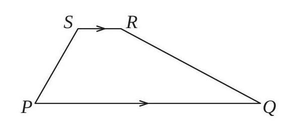

# AVP0265 — Single visual target

MathVision:1741 / MathVerse:546 · different type · Geometric markers

## Shared or similar visual information

A right-pointing chevron or arrowhead on a line.

## Evidence locations

- Left image: The right-pointing chevrons centered on SR and PQ, rather than at their endpoints.
- Right image: The magenta arrowhead at the right end of the horizontal span joining two neighboring peaks.

## Mathematical meanings

Left image: The matching arrow marks state that SR and PQ are parallel. Right image: It bounds a horizontal-coordinate interval between adjacent peaks of the plotted wave.

## Same mathematical meanings

no

## Rationales

The left chevrons occur as a matching pair inside geometric sides and assert parallelism. The selected right arrowhead instead bounds a plotted interval or indicates continuation of an axis or function branch, as identified by its attachment to that element.

Only the selected target is annotated. AI visual-review draft; not independently double-annotated by humans.
