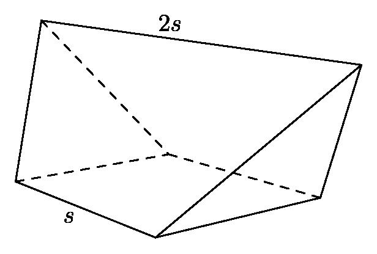
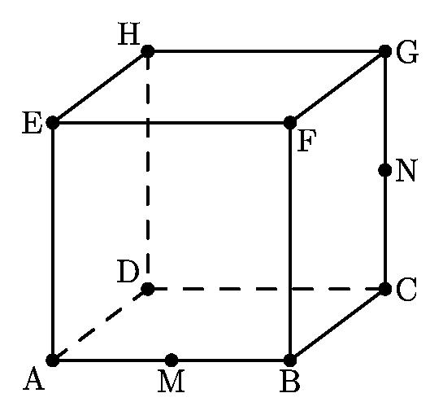

# AVP0269 — Single visual target

MathVision:2036 / MathVision:2078 · same type · Geometric markers

## Shared or similar visual information

A boundary or edge drawn with broken strokes in a three-dimensional solid view.

## Evidence locations

- Left image: The dashed segments from the interior rear vertex toward the left and right base vertices.
- Right image: The dashed back-bottom edge DC of the cube.

## Mathematical meanings

Left image: They represent rear edges of the solid that are hidden from this viewing direction. Right image: It represents the hidden rear bottom edge DC of the cube.

## Same mathematical meanings

yes

## Rationales

Both selected broken lines belong to the rear, occluded part of the depicted solid. They use the hidden-edge convention, even when one boundary is curved or one drawing uses dots rather than longer dashes.

Only the selected target is annotated. AI visual-review draft; not independently double-annotated by humans.
