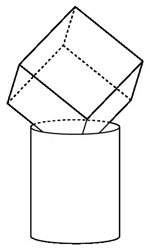
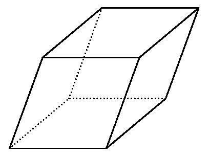

# AVP0272 — Single visual target

MathVision:2088 / MathVision:2103 · same type · Geometric markers

## Shared or similar visual information

A boundary or edge drawn with broken strokes in a three-dimensional solid view.

## Evidence locations

- Left image: The dotted edge running from the rear interior cube vertex up toward the top cube vertex.
- Right image: The dotted horizontal back-bottom edge inside the sloping parallelepiped.

## Mathematical meanings

Left image: It represents an edge on the back of the cube, hidden in the solid view. Right image: It represents a hidden rear edge of the three-dimensional solid.

## Same mathematical meanings

yes

## Rationales

Both selected broken lines belong to the rear, occluded part of the depicted solid. They use the hidden-edge convention, even when one boundary is curved or one drawing uses dots rather than longer dashes.

Only the selected target is annotated. AI visual-review draft; not independently double-annotated by humans.
