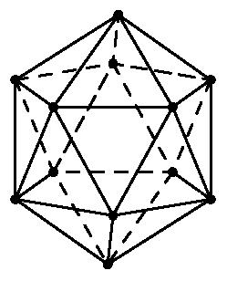
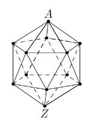

# AVP0273 — Single visual target

MathVision:2090 / MathVision:2836 · same type · Geometric markers

## Shared or similar visual information

A boundary or edge drawn with broken strokes in a three-dimensional solid view.

## Evidence locations

- Left image: A dashed edge of the rear pentagonal ring inside the wireframe icosahedron.
- Right image: A dashed rear edge inside the wireframe icosahedron between A and Z.

## Mathematical meanings

Left image: It represents an edge on the hidden rear part of the icosahedron. Right image: It represents a hidden rear edge of the icosahedron.

## Same mathematical meanings

yes

## Rationales

Both selected broken lines belong to the rear, occluded part of the depicted solid. They use the hidden-edge convention, even when one boundary is curved or one drawing uses dots rather than longer dashes.

Only the selected target is annotated. AI visual-review draft; not independently double-annotated by humans.
