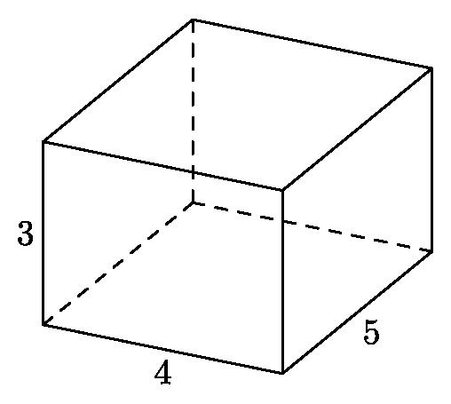
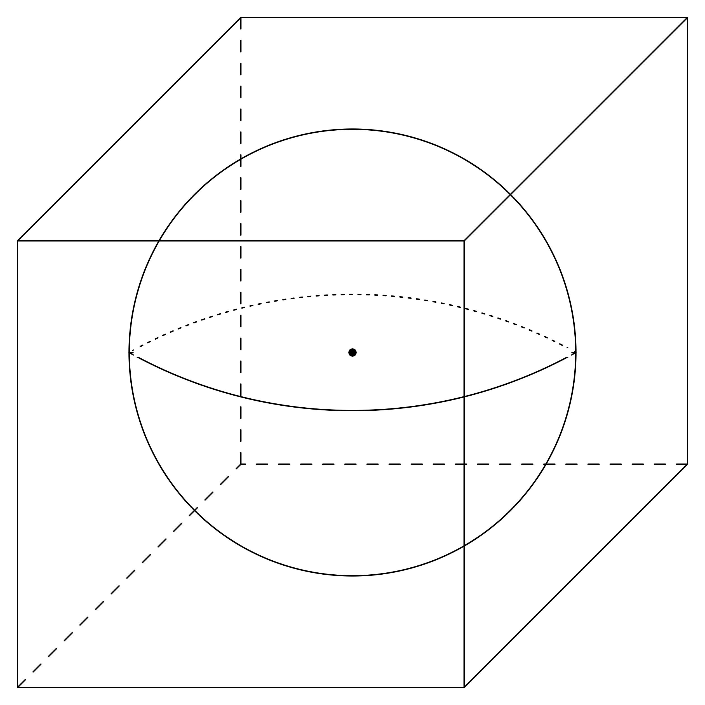

# AVP0274 — Single visual target

MathVision:2206 / MathVision:2942 · same type · Geometric markers

## Shared or similar visual information

A boundary or edge drawn with broken strokes in a three-dimensional solid view.

## Evidence locations

- Left image: The dashed horizontal edge from the interior rear lower vertex toward the right lower vertex.
- Right image: The dashed horizontal back-bottom edge of the enclosing cube.

## Mathematical meanings

Left image: It represents a hidden rear edge of the rectangular prism. Right image: It represents a hidden rear edge of the cube, behind the sphere in the drawing.

## Same mathematical meanings

yes

## Rationales

Both selected broken lines belong to the rear, occluded part of the depicted solid. They use the hidden-edge convention, even when one boundary is curved or one drawing uses dots rather than longer dashes.

Only the selected target is annotated. AI visual-review draft; not independently double-annotated by humans.
