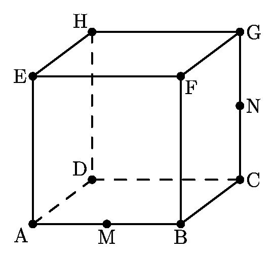
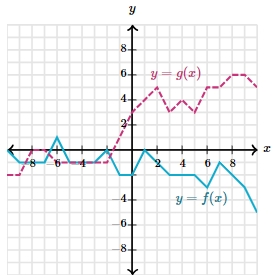

# AVP0279 — Single visual target

MathVision:2078 / MathVerse:557 · different type · Geometric markers

## Shared or similar visual information

A line or boundary made of separated short strokes.

## Evidence locations

- Left image: The dashed back-bottom edge DC of the cube.
- Right image: The magenta dashed polyline labeled y=g(x).

## Mathematical meanings

Left image: It represents the hidden rear bottom edge DC of the cube. Right image: The dashed polyline is the plotted graph of function g, visually separated from solid graph f.

## Same mathematical meanings

no

## Rationales

The left dashes convey occlusion in a three-dimensional wireframe. The visible y=g(x) label attaches the right dashes to the function curve itself. The two stroke styles therefore encode different contextual functions.

Only the selected target is annotated. AI visual-review draft; not independently double-annotated by humans.
