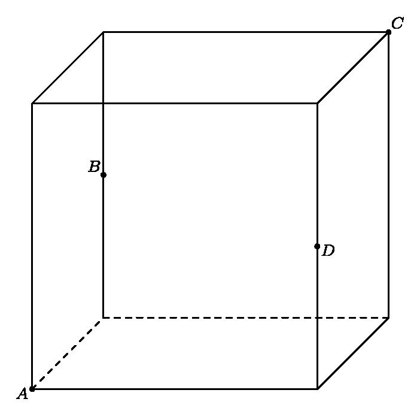

# AVP0280 — Single visual target

MathVision:2163 / MathVerse:568 · different type · Geometric markers

## Shared or similar visual information

A line or boundary made of separated short strokes.

## Evidence locations

- Left image: The dashed horizontal back-bottom edge of the cube.
- Right image: The magenta dashed upward-opening curve labeled g.

## Mathematical meanings

Left image: It represents a hidden rear bottom edge of the cube. Right image: The dashed curve is the plotted graph of function g, distinguished from the solid graph f.

## Same mathematical meanings

no

## Rationales

The left dashes convey occlusion in a three-dimensional wireframe. The g label identifies the right magenta dashes as a plotted function, not an invisible edge. The two stroke styles therefore encode different contextual functions.

Only the selected target is annotated. AI visual-review draft; not independently double-annotated by humans.
