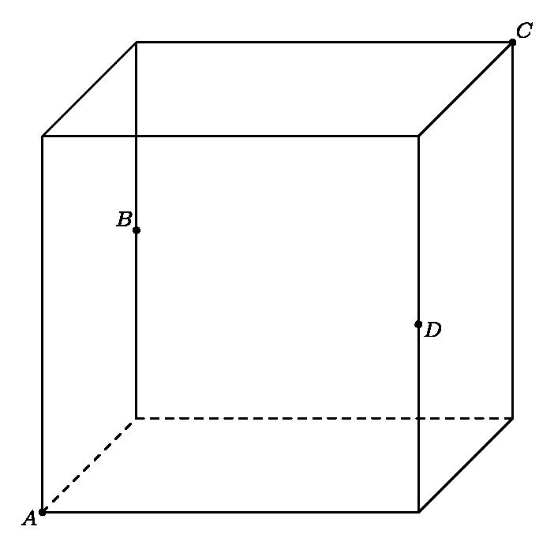
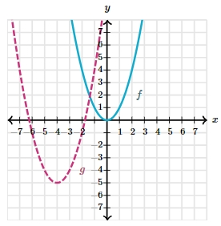

# AVP0280 — Single visual target

MathVista:33 / MathVerse:568 · different type · Geometric markers

## Shared or similar visual information

A dashed curve.

## Evidence locations

- Left image: The dashed curved rear portion of the cone base.
- Right image: The dashed magenta parabola labeled g.

## Mathematical meanings

Left image: The arc traces the hidden portion of the circular base rim. Right image: The curve traces the graph of function g.

## Same mathematical meanings

no

## Rationales

The dashed arc denotes occlusion in the solid drawing. The dashed parabola depicts a function and its style distinguishes it from f.

Only the selected target is annotated. AI visual-review draft; not independently double-annotated by humans.
