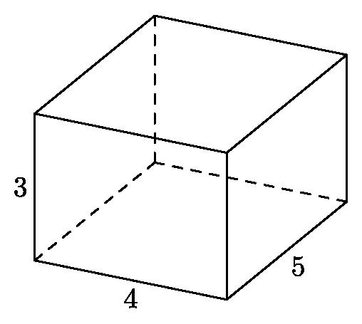
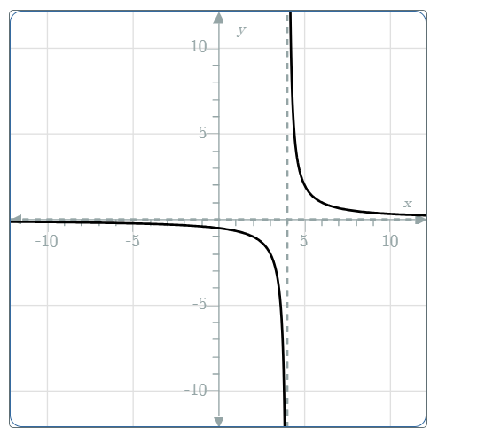

# AVP0281 — Single visual target

MathVision:2206 / MathVerse:582 · different type · Geometric markers

## Shared or similar visual information

A line or boundary made of separated short strokes.

## Evidence locations

- Left image: The dashed horizontal edge from the interior rear lower vertex toward the right lower vertex.
- Right image: The nearly vertical black dashed line beside the two branches of the curve.

## Mathematical meanings

Left image: It represents a hidden rear edge of the rectangular prism. Right image: It is the vertical asymptote used as a reference for the plotted function.

## Same mathematical meanings

no

## Rationales

The left dashes convey occlusion in a three-dimensional wireframe. The right broken vertical reference is an asymptote beside a function curve, with no solid to supply an occluded edge. The two stroke styles therefore encode different contextual functions.

Only the selected target is annotated. AI visual-review draft; not independently double-annotated by humans.
