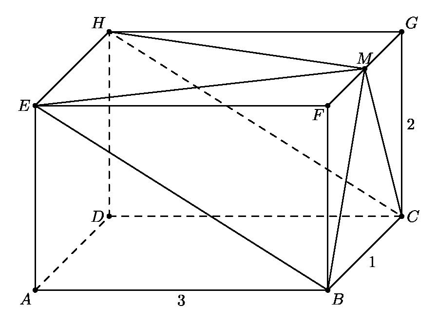

# AVP0282 — Single visual target

MathVision:2220 / MathVerse:535 · different type · Geometric markers

## Shared or similar visual information

A line or boundary made of separated short strokes.

## Evidence locations

- Left image: The dashed segment DC along the back-bottom edge of the rectangular prism.
- Right image: The horizontal magenta dashed reference line crossing the wave.

## Mathematical meanings

Left image: It represents the hidden rear bottom edge DC of the prism. Right image: It is a horizontal reference line through the wave, rather than the wave curve itself.

## Same mathematical meanings

no

## Rationales

The left dashes convey occlusion in a three-dimensional wireframe. The right horizontal dashes run across the wave as a plotting reference rather than tracing a hidden object boundary. The two stroke styles therefore encode different contextual functions.

Only the selected target is annotated. AI visual-review draft; not independently double-annotated by humans.
