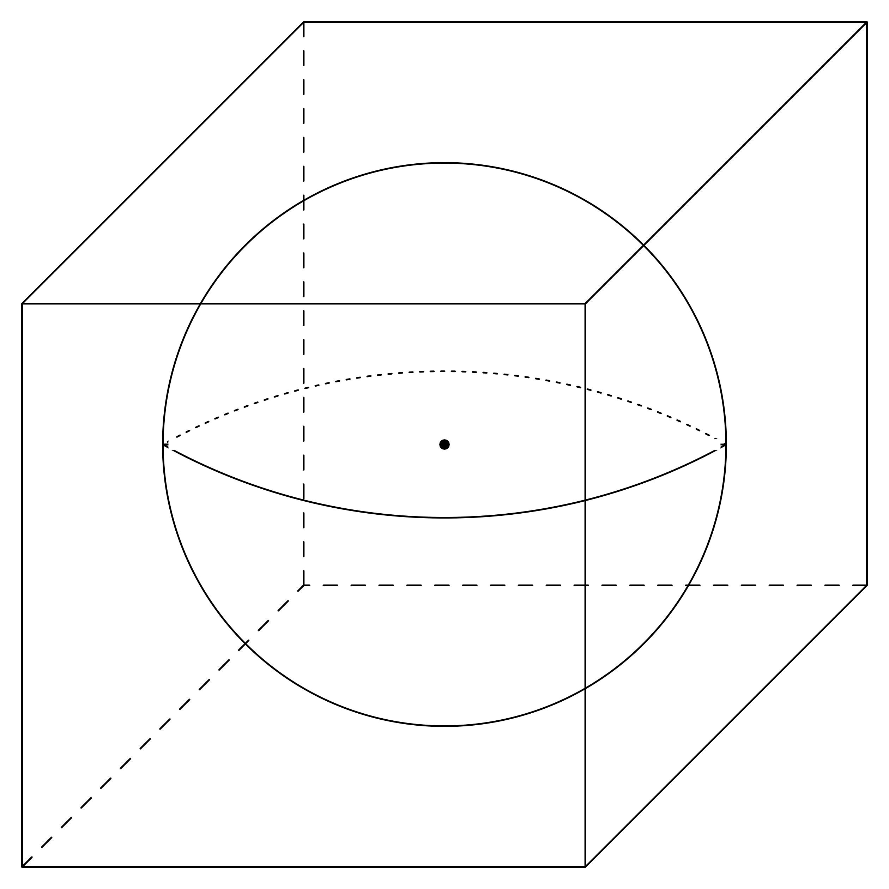
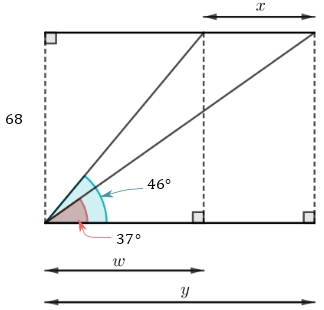

# AVP0283 — Single visual target

MathVision:2942 / MathVerse:358 · different type · Geometric markers

## Shared or similar visual information

A line or boundary made of separated short strokes.

## Evidence locations

- Left image: The dashed horizontal back-bottom edge of the enclosing cube.
- Right image: The central vertical dashed segment from the upper line down to the base.

## Mathematical meanings

Left image: It represents a hidden rear edge of the cube, behind the sphere in the drawing. Right image: It is an auxiliary perpendicular projection segment used to construct a right triangle.

## Same mathematical meanings

no

## Rationales

The left dashes convey occlusion in a three-dimensional wireframe. The right dashed projection ends at an explicit right-angle foot on the base, establishing a planar perpendicular construction. The two stroke styles therefore encode different contextual functions.

Only the selected target is annotated. AI visual-review draft; not independently double-annotated by humans.
