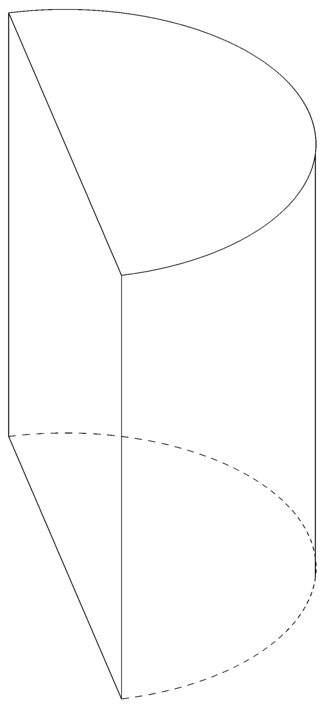

# AVP0284 — Single visual target

MathVision:2965 / MathVerse:359 · different type · Geometric markers

## Shared or similar visual information

A line or boundary made of separated short strokes.

## Evidence locations

- Left image: The dashed curved half of the lower circular boundary of the cut cylinder.
- Right image: The horizontal dashed line extending rightward from the upper-left vertex.

## Mathematical meanings

Left image: It represents the rear curved base boundary that is hidden from this viewing direction. Right image: It is a horizontal auxiliary construction line through the upper vertex of the plane diagram.

## Same mathematical meanings

no

## Rationales

The left dashes convey occlusion in a three-dimensional wireframe. The right dashes extend a horizontal reference from the top vertex in a plane trigonometric construction. The two stroke styles therefore encode different contextual functions.

Only the selected target is annotated. AI visual-review draft; not independently double-annotated by humans.
