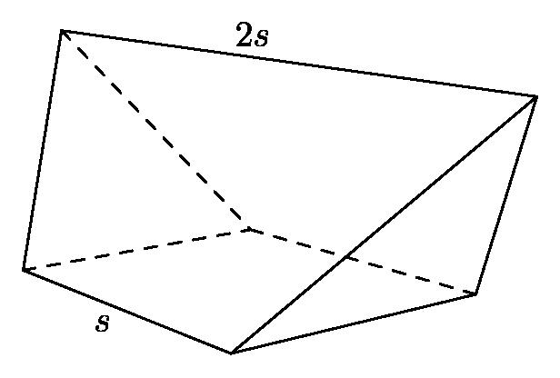
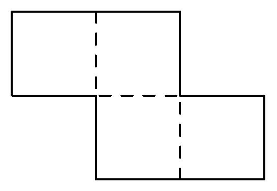

# AVP0285 — Single visual target

MathVision:2036 / MathVision:2540 · different type · Geometric markers

## Shared or similar visual information

A line or boundary made of separated short strokes.

## Evidence locations

- Left image: The dashed segments from the interior rear vertex toward the left and right base vertices.
- Right image: The dashed horizontal segment inside the two-rectangle planar figure.

## Mathematical meanings

Left image: They represent rear edges of the solid that are hidden from this viewing direction. Right image: It marks an interior subdivision of the planar figure, rather than a hidden edge of a solid.

## Same mathematical meanings

no

## Rationales

The left dashes convey occlusion in a three-dimensional wireframe. The right dashes subdivide the interior of a flat composite outline and are distinct from its outer perimeter. The two stroke styles therefore encode different contextual functions.

Only the selected target is annotated. AI visual-review draft; not independently double-annotated by humans.
