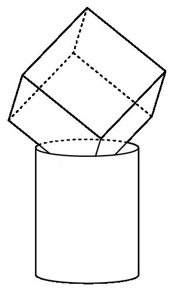
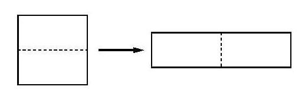

# AVP0286 — Single visual target

MathVision:2088 / MathVision:832 · different type · Geometric markers

## Shared or similar visual information

A line or boundary made of separated short strokes.

## Evidence locations

- Left image: The dotted edge running from the rear interior cube vertex up toward the top cube vertex.
- Right image: The horizontal dashed divider inside the left square, before the right-pointing transformation arrow.

## Mathematical meanings

Left image: It represents an edge on the back of the cube, hidden in the solid view. Right image: It marks the partition of the square into the pieces used to form the rectangle.

## Same mathematical meanings

no

## Rationales

The left dashes convey occlusion in a three-dimensional wireframe. The right dashes partition the square in a before-and-after piece rearrangement diagram. The two stroke styles therefore encode different contextual functions.

Only the selected target is annotated. AI visual-review draft; not independently double-annotated by humans.
