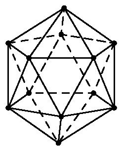
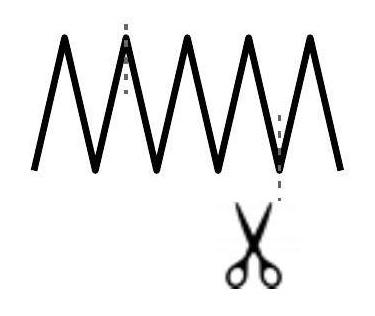

# AVP0287 — Single visual target

MathVision:2090 / MathVision:855 · different type · Geometric markers

## Shared or similar visual information

A line or boundary made of separated short strokes.

## Evidence locations

- Left image: A dashed edge of the rear pentagonal ring inside the wireframe icosahedron.
- Right image: The vertical broken line rising from the scissors through the zigzag wire.

## Mathematical meanings

Left image: It represents an edge on the hidden rear part of the icosahedron. Right image: It indicates a cut position through the folded wire.

## Same mathematical meanings

no

## Rationales

The left dashes convey occlusion in a three-dimensional wireframe. The scissors and the vertical broken guide on the right explicitly identify a cutting position through the wire. The two stroke styles therefore encode different contextual functions.

Only the selected target is annotated. AI visual-review draft; not independently double-annotated by humans.
