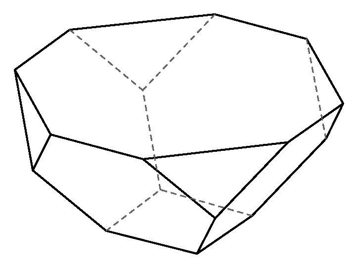
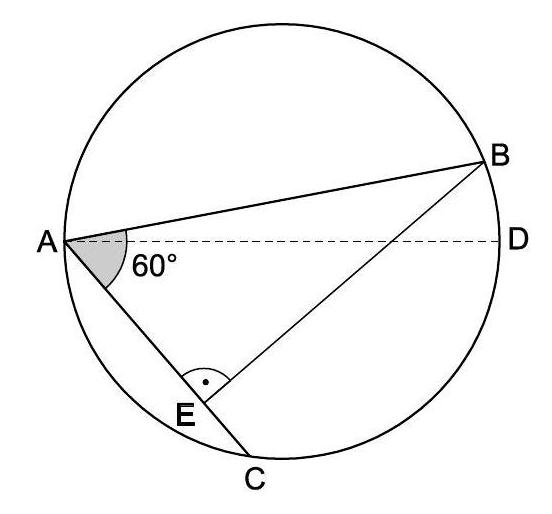

# AVP0288 — Single visual target

MathVision:2246 / MathVision:1424 · different type · Geometric markers

## Shared or similar visual information

A line or boundary made of separated short strokes.

## Evidence locations

- Left image: The dashed rear edges running from the upper rim toward the back central junction of the bowl.
- Right image: The dashed segment from A across the circle to D.

## Mathematical meanings

Left image: They represent rear edges of the folded three-dimensional bowl that are hidden from view. Right image: It is an auxiliary chord-like reference segment within the plane circle diagram.

## Same mathematical meanings

no

## Rationales

The left dashes convey occlusion in a three-dimensional wireframe. The right dashed AD segment is a planar reference across a circle, not the occluded boundary of a solid. The two stroke styles therefore encode different contextual functions.

Only the selected target is annotated. AI visual-review draft; not independently double-annotated by humans.
