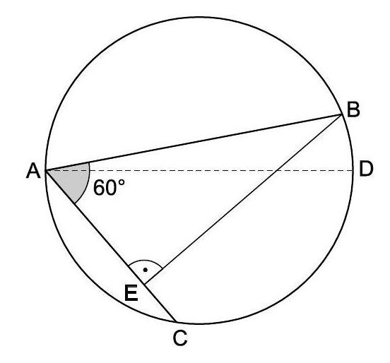
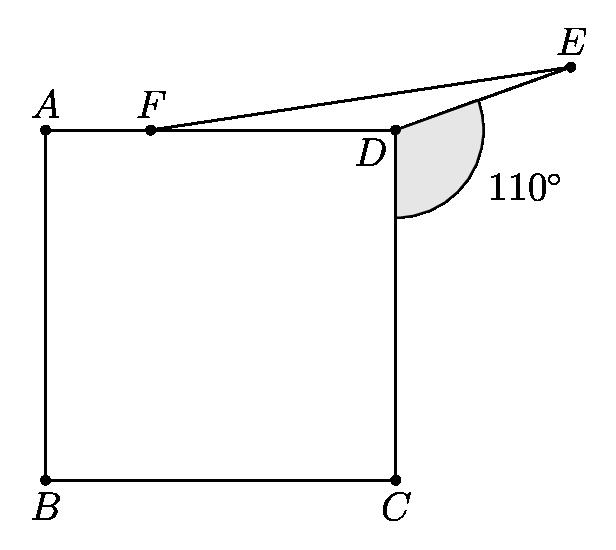

# AVP0289 — Single visual target

MathVision:1424 / MathVision:2231 · same type · Geometric markers

## Shared or similar visual information

A small circular arc placed between two rays at their common vertex.

## Evidence locations

- Left image: The small circular arc bounding the gray 60° region at A.
- Right image: The arc bounding the shaded 110° region at D.

## Mathematical meanings

Left image: It selects the vertex angle at A to which the 60° label is attached. Right image: It selects the angle at D associated with the 110° label.

## Same mathematical meanings

yes

## Rationales

Each small arc selects a particular vertex angle and connects it to the nearby angle label or to the marked-angle relation. The target is that angle-selection convention, not equality of all labeled angle values.

Only the selected target is annotated. AI visual-review draft; not independently double-annotated by humans.
