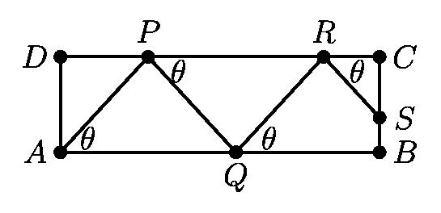
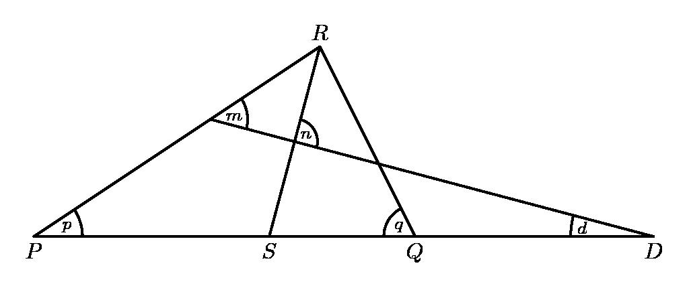

# AVP0292 — Single visual target

MathVision:2501 / MathVision:2260 · same type · Geometric markers

## Shared or similar visual information

A small circular arc placed between two rays at their common vertex.

## Evidence locations

- Left image: The small arc beside theta at A, between AP and the lower horizontal side.
- Right image: The small arc beside p at the left base vertex P.

## Mathematical meanings

Left image: It singles out the angle at A denoted by theta. Right image: It selects the vertex angle at P denoted by p.

## Same mathematical meanings

yes

## Rationales

Each small arc selects a particular vertex angle and connects it to the nearby angle label or to the marked-angle relation. The target is that angle-selection convention, not equality of all labeled angle values.

Only the selected target is annotated. AI visual-review draft; not independently double-annotated by humans.
