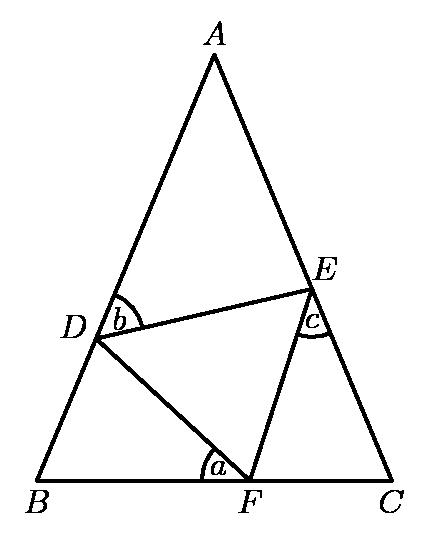
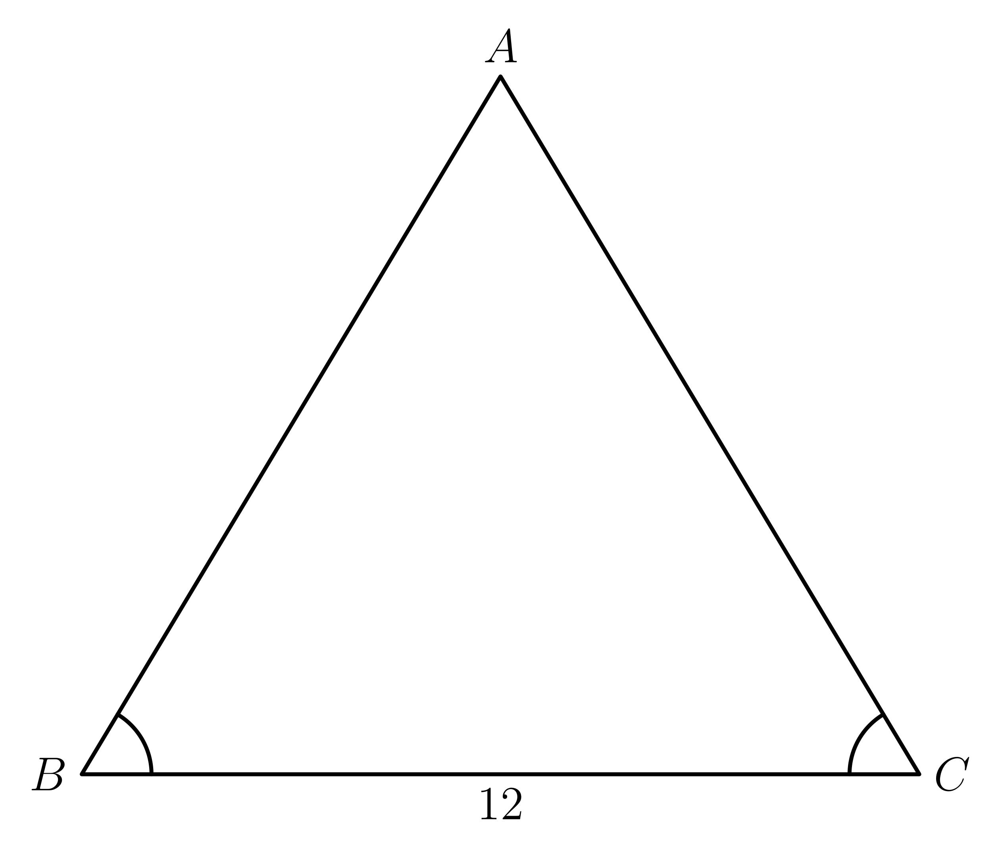

# AVP0294 — Single visual target

MathVision:2276 / MathVision:2939 · same type · Geometric markers

## Shared or similar visual information

A small circular arc placed between two rays at their common vertex.

## Evidence locations

- Left image: The small arc beside b at D inside the triangle.
- Right image: The small arc at B between BA and BC.

## Mathematical meanings

Left image: It selects the angle at D associated with the variable b. Right image: It identifies the vertex angle at B as a marked angle.

## Same mathematical meanings

yes

## Rationales

Each small arc selects a particular vertex angle and connects it to the nearby angle label or to the marked-angle relation. The target is that angle-selection convention, not equality of all labeled angle values.

Only the selected target is annotated. AI visual-review draft; not independently double-annotated by humans.
