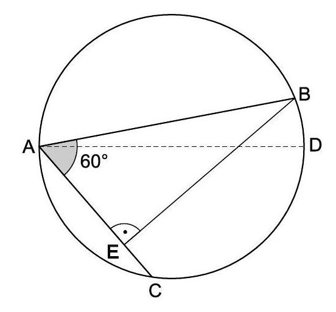
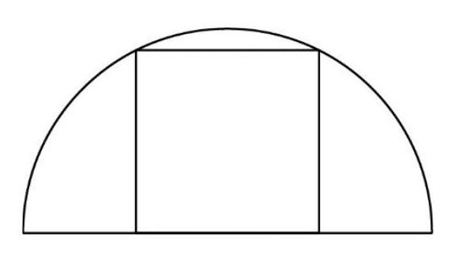

# AVP0295 — Single visual target

MathVision:1424 / MathVision:1434 · same type · Geometric markers

## Shared or similar visual information

A circular arc-shaped stroke.

## Evidence locations

- Left image: The small circular arc bounding the gray 60° region at A.
- Right image: The outer semicircular arc above the inscribed rectangle.

## Mathematical meanings

Left image: It selects the vertex angle at A to which the 60° label is attached. Right image: It is the curved boundary of the semicircular geometric figure.

## Same mathematical meanings

no

## Rationales

The left arc is a small angle marker placed at a vertex. The right arc is part of the actual circumference of a circle or semicircle in the geometric object. One selects an angle; the other supplies a geometric boundary.

Only the selected target is annotated. AI visual-review draft; not independently double-annotated by humans.
