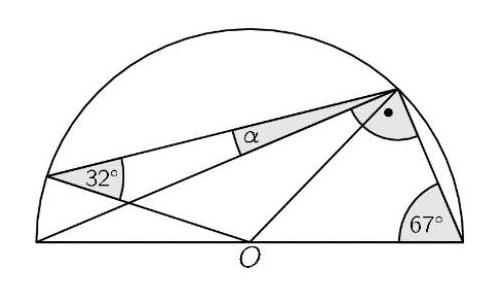
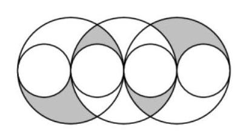

# AVP0296 — Single visual target

MathVision:1458 / MathVision:1472 · same type · Geometric markers

## Shared or similar visual information

A circular arc-shaped stroke.

## Evidence locations

- Left image: The small arc bounding the 67° region at the lower-right end of the semicircle.
- Right image: The upper circular arc surrounding the left pair of inner circles.

## Mathematical meanings

Left image: It selects the vertex angle associated with the 67° label. Right image: It is part of a circle boundary in the overlapping-circle diagram.

## Same mathematical meanings

no

## Rationales

The left arc is a small angle marker placed at a vertex. The right arc is part of the actual circumference of a circle or semicircle in the geometric object. One selects an angle; the other supplies a geometric boundary.

Only the selected target is annotated. AI visual-review draft; not independently double-annotated by humans.
