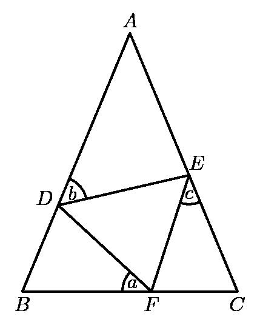
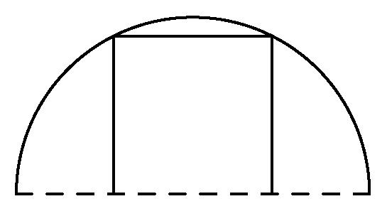

# AVP0297 — Single visual target

MathVision:2276 / MathVision:2157 · same type · Geometric markers

## Shared or similar visual information

A circular arc-shaped stroke.

## Evidence locations

- Left image: The small arc beside b at D inside the triangle.
- Right image: The outer semicircular arc above the rectangle and the dashed diameter.

## Mathematical meanings

Left image: It selects the angle at D associated with the variable b. Right image: It is the curved boundary of the semicircular figure.

## Same mathematical meanings

no

## Rationales

The left arc is a small angle marker placed at a vertex. The right arc is part of the actual circumference of a circle or semicircle in the geometric object. One selects an angle; the other supplies a geometric boundary.

Only the selected target is annotated. AI visual-review draft; not independently double-annotated by humans.
