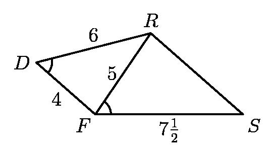
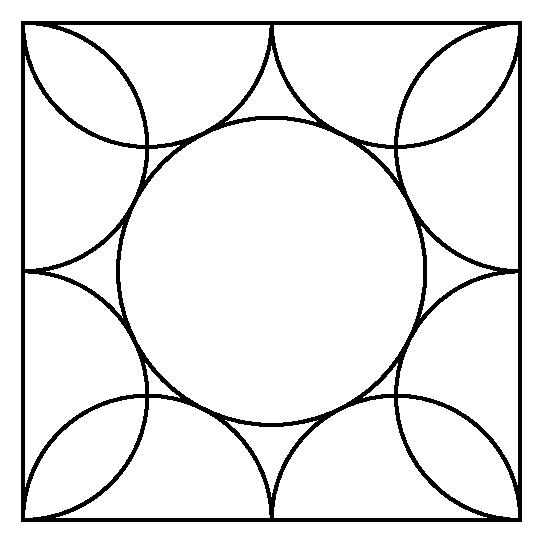

# AVP0298 — Single visual target

MathVision:2281 / MathVision:2200 · same type · Geometric markers

## Shared or similar visual information

A circular arc-shaped stroke.

## Evidence locations

- Left image: The small arc at D between DR and DF.
- Right image: A circular arc inside the upper-left corner of the outer square.

## Mathematical meanings

Left image: It singles out the angle formed by DR and DF at D. Right image: It forms part of a circular boundary in the composite circle-and-square figure.

## Same mathematical meanings

no

## Rationales

The left arc is a small angle marker placed at a vertex. The right arc is part of the actual circumference of a circle or semicircle in the geometric object. One selects an angle; the other supplies a geometric boundary.

Only the selected target is annotated. AI visual-review draft; not independently double-annotated by humans.
