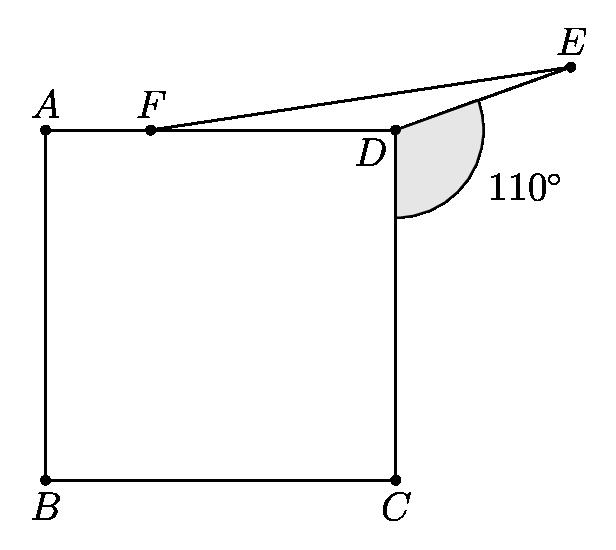
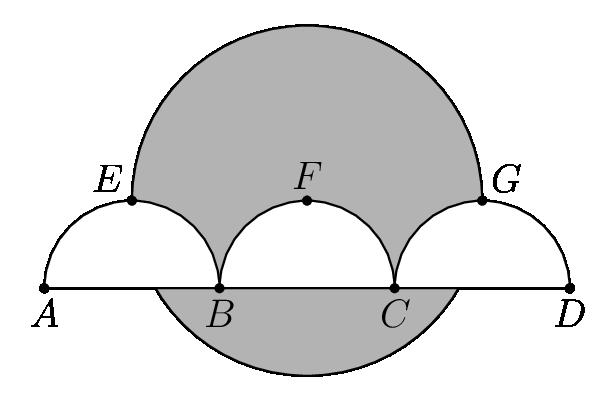

# AVP0299 — Single visual target

MathVision:2231 / MathVision:2225 · same type · Geometric markers

## Shared or similar visual information

A circular arc-shaped stroke.

## Evidence locations

- Left image: The arc bounding the shaded 110° region at D.
- Right image: The large upper semicircular arc from E through the top to G.

## Mathematical meanings

Left image: It selects the angle at D associated with the 110° label. Right image: It is the boundary of a semicircular region in the composite area diagram.

## Same mathematical meanings

no

## Rationales

The left arc is a small angle marker placed at a vertex. The right arc is part of the actual circumference of a circle or semicircle in the geometric object. One selects an angle; the other supplies a geometric boundary.

Only the selected target is annotated. AI visual-review draft; not independently double-annotated by humans.
