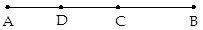
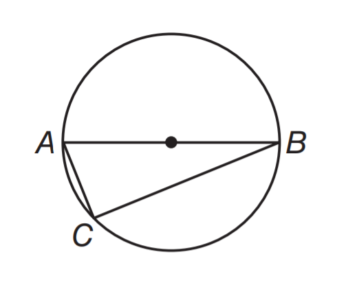

# AVP0302 — Single visual target

MathVista:6 / MathVista:28 · same type · Mathematical roles of symbols

## Shared or similar visual information

The letter B

## Evidence locations

- Left image: B above the right endpoint of the horizontal segment
- Right image: B at the right endpoint of the diameter

## Mathematical meanings

Left image: B names the indicated geometric point. Right image: B names the indicated geometric point.

## Same mathematical meanings

yes

## Rationales

The left occurrence is located at B above the right endpoint of the horizontal segment; the right occurrence is at B at the right endpoint of the diameter. Both use the selected notation for the same point-naming function. This compares the local role, without asserting that the two underlying objects or unknown values are identical.

Only the selected target is annotated. AI visual-review draft; not independently double-annotated by humans.
