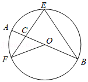
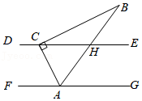

# AVP0304 — Single visual target

MathVista:35 / MathVista:55 · same type · Mathematical roles of symbols

## Shared or similar visual information

The letter C

## Evidence locations

- Left image: C beside the intersection of chords inside the circle
- Right image: C at the angle vertex on the upper horizontal line

## Mathematical meanings

Left image: C names the indicated geometric point. Right image: C names the indicated geometric point.

## Same mathematical meanings

yes

## Rationales

The left occurrence is located at C beside the intersection of chords inside the circle; the right occurrence is at C at the angle vertex on the upper horizontal line. Both use the selected notation for the same point-naming function. This compares the local role, without asserting that the two underlying objects or unknown values are identical.

Only the selected target is annotated. AI visual-review draft; not independently double-annotated by humans.
