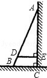
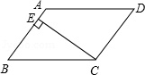

# AVP0308 — Single visual target

MathVista:141 / MathVista:164 · same type · Mathematical roles of symbols

## Shared or similar visual information

The letter E

## Evidence locations

- Left image: E at the end of the short horizontal segment on the right
- Right image: E at the right-angle foot on the left sloping side

## Mathematical meanings

Left image: E names the indicated geometric point. Right image: E names the indicated geometric point.

## Same mathematical meanings

yes

## Rationales

The left occurrence is located at E at the end of the short horizontal segment on the right; the right occurrence is at E at the right-angle foot on the left sloping side. Both use the selected notation for the same point-naming function. This compares the local role, without asserting that the two underlying objects or unknown values are identical.

Only the selected target is annotated. AI visual-review draft; not independently double-annotated by humans.
