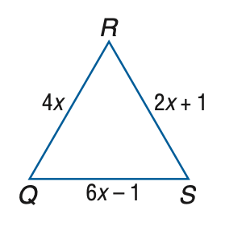
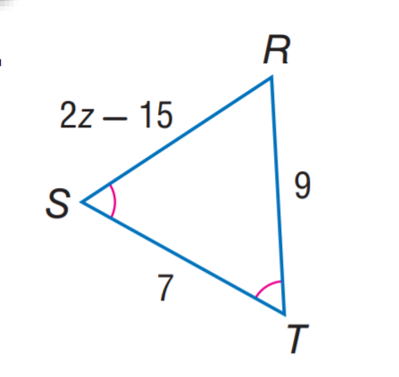

# AVP0309 — Single visual target

MathVista:176 / MathVista:236 · same type · Mathematical roles of symbols

## Shared or similar visual information

The letter R

## Evidence locations

- Left image: R at the top vertex of the triangle
- Right image: R at the upper-right triangle vertex

## Mathematical meanings

Left image: R names the indicated geometric point. Right image: R names the indicated geometric point.

## Same mathematical meanings

yes

## Rationales

The left occurrence is located at R at the top vertex of the triangle; the right occurrence is at R at the upper-right triangle vertex. Both use the selected notation for the same point-naming function. This compares the local role, without asserting that the two underlying objects or unknown values are identical.

Only the selected target is annotated. AI visual-review draft; not independently double-annotated by humans.
