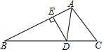
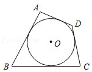

# AVP0313 — Single visual target

MathVista:256 / MathVista:274 · same type · Mathematical roles of symbols

## Shared or similar visual information

The letter A

## Evidence locations

- Left image: A at the top of the main triangle
- Right image: A at the upper triangle vertex above the inscribed circle

## Mathematical meanings

Left image: A names the indicated geometric point. Right image: A names the indicated geometric point.

## Same mathematical meanings

yes

## Rationales

The left occurrence is located at A at the top of the main triangle; the right occurrence is at A at the upper triangle vertex above the inscribed circle. Both use the selected notation for the same point-naming function. This compares the local role, without asserting that the two underlying objects or unknown values are identical.

Only the selected target is annotated. AI visual-review draft; not independently double-annotated by humans.
